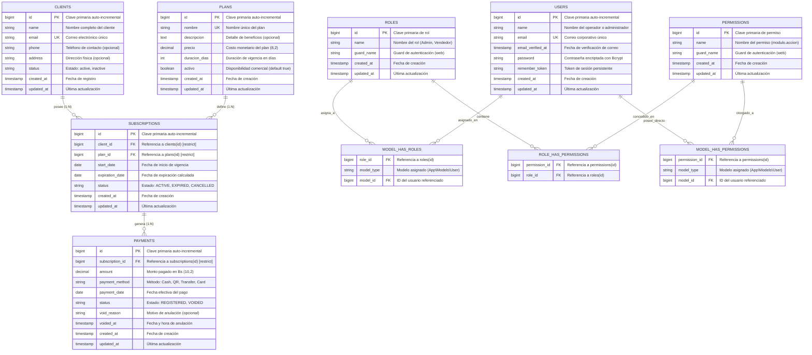

# Diagrama Entidad-Relación (ER) - Laravel Finor

Este documento contiene la especificación del modelo de base de datos relacional para el sistema de gestión de suscripciones y pagos **Laravel Finor**, generado a partir de las migraciones finales de la base de datos.

---

## Diagrama ER en Mermaid

---

## Diccionario de Entidades y Cardinalidades

### 1. Dominio de Negocio (Core)

| Relación | Tipo | Restricción de Integridad | Descripción |
| :--- | :---: | :--- | :--- |
| **`clients` ➔ `subscriptions`** | `1 : N` | `ON DELETE RESTRICT` | Un cliente puede tener múltiples suscripciones a lo largo del tiempo, pero una suscripción pertenece a un único cliente. |
| **`plans` ➔ `subscriptions`** | `1 : N` | `ON DELETE RESTRICT` | Un plan puede aplicarse a muchas suscripciones; la suscripción referencia un único plan que determina precio y días. |
| **`subscriptions` ➔ `payments`** | `1 : N` | `ON DELETE RESTRICT` / `CASCADE UPDATE` | Una suscripción puede recibir uno o más abonos/pagos registrados hasta cubrir el saldo. Un pago está asociado a una única suscripción. |

### 2. Dominio de Seguridad y Acceso (Spatie RBAC)

| Relación | Tipo | Descripción |
| :--- | :---: | :--- |
| **`users` ➔ `roles`** | `N : M` | Mediante la tabla pivote polimórfica `model_has_roles`. |
| **`roles` ➔ `permissions`** | `N : M` | Mediante la tabla pivote `role_has_permissions`. |
| **`users` ➔ `permissions`** | `N : M` | Mediante `model_has_permissions` (para asignaciones directas sin pasar por rol). |

---

## Enumeraciones y Valores Permitidos

### 1. `SubscriptionStatus` (`app/Enums/SubscriptionStatus.php`)
- `ACTIVE`: Suscripción vigente dentro del período de inicio y vencimiento.
- `EXPIRED`: Suscripción cuya fecha límite ha pasado.
- `CANCELLED`: Suscripción interrumpida manualmente por el operador.

### 2. `PaymentStatus` (`app/Enums/PaymentStatus.php`)
- `REGISTERED`: Pago válido asentado en caja.
- `VOIDED`: Pago anulado por error administrativo, registrando `void_reason` y marca temporal en `voided_at`.

### 3. `PaymentMethod` (`app/Enums/PaymentMethod.php`)
- `CASH`: Pago en efectivo en caja física.
- `QR`: Pago inmediato mediante código QR interoperable.
- `TRANSFER`: Transferencia bancaria directa.
- `CARD`: Pago con tarjeta de débito o crédito.
